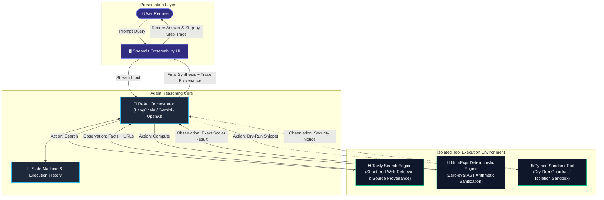

# Reactron ⚡

**A Production-Grade ReAct Agent Architecture with Grounded Web Retrieval, Deterministic Math Engine, and End-to-End Execution Observability.**

[](https://www.python.org/)
[](https://www.langchain.com/)
[](https://streamlit.io/)
[](https://tavily.com/)
---

## 📌 Executive Summary

Modern Large Language Models (LLMs) excel at natural language synthesis and contextual planning, but they are fundamentally **stochastic next-token predictors**. When deployed in mission-critical analytical workflows, they exhibit two critical failure modes:

1. **Temporal Horizon Limitations & Knowledge Cutoffs:** Inability to retrieve live, authoritative empirical facts without hallucinating.
2. **Arithmetic Incompetence:** Performing multi-step arithmetic via token probabilities rather than an Arithmetic Logic Unit (ALU), resulting in catastrophic inaccuracies with large numbers or non-trivial formulas.

**Reactron** solves this by implementing the **ReAct (Reasoning + Acting)** paradigm ([Yao et al., 2022](https://arxiv.org/abs/2210.03629)). Reactron orchestrates a decoupled agent architecture that dynamically assesses query complexity, fetches real-time citations via **Tavily Web Search**, executes arithmetic deterministically via an isolated **NumExpr C-engine**, and renders an inspectable execution trace in a modern **Streamlit** dashboard.

---

## 🏗️ System Architecture



---

## 🔍 Key Engineering Highlights

### 1. Deterministic Math Engine (`tools/calculator_tool.py`)
* **Elimination of `eval()`:** Python's built-in `eval()` is a critical security vulnerability and prone to arbitrary code execution. Reactron utilizes `numexpr`, compiling math expressions into optimized C bytecode.
* **Namespace Isolation:** Evaluated with isolated local and global dictionaries (`local_dict={}`, `global_dict={}`), preventing memory tampering or identifier resolution attacks.
* **Pre-Execution Sanitization:** Strict regex character allowlisting (`[0-9+\-*/().\s%^]`), automated bracket-depth validation, comma thousands-separator stripping (`170,000,000` $\to$ `170000000`), and percentage pre-compilation.

### 2. Grounded Web Retrieval (`tools/search_tool.py`)
* **Real-Time Fact Sourcing:** Interfaces directly with Tavily's Search API for dense factual extraction, stripping noise and reducing context token overhead.
* **URL & Fact Provenance:** Automatically preserves origin URLs and context snippets, ensuring all final assertions can be audited against external primary sources.
* **Unicode Normalization & Resiliency:** Normalizes non-standard typography (mathematical dashes, unicode quotes) to prevent console and display codec crashes on heterogeneous runtime environments.

### 3. Transparent Execution Traces (Observability)
* Full lifecycle visibility into the agent's internal loop:
  * **Decision Summary:** Tool selection rationale.
  * **Tool Inputs:** Structured parameters emitted by the model.
  * **Observations:** Raw outputs received back from the environment.
  * **Final Synthesis:** Context-grounded response with citation provenance.

### 4. Zero-Trust Python Guardrails
* Model-generated code is inherently untrusted. Reactron implements Python execution as an explicit **dry-run / disabled-by-default** tool to eliminate remote code execution (RCE) vectors during baseline operations.

---

## 🧪 Testing & Verification

The test harness enforces rigorous unit validation across deterministic math, injection rejection, search formatting, and exception containment.

Run the complete test suite:

```bash
python -m unittest discover tests -v
```

### Test Coverage Highlights
* **Calculator (`tests/test_calculator.py`):**
  * Blueprint benchmark expressions: `12 * 8` $\to$ `96`, `(150 - 120) / 120 * 100` $\to$ `25`, `5 / 100 * 170,000,000` $\to$ `8500000`.
  * Security test cases rejecting `__import__('os')`, variable injections, and malicious syntax.
  * Parentheses imbalance and zero-division recovery.
* **Search Engine (`tests/test_tools.py`):**
  * Mocked payload parsing and format validation.
  * Fault injection: missing API keys, expired quotas, network disconnects.
  * Live end-to-end Tavily verification.

---

## 🖥️ Running the Application

Launch the Streamlit interactive dashboard:

```bash
streamlit run app.py
```

Navigate to `http://localhost:8501` in your browser.

### Example Walkthrough Query
> *"Search for the latest population estimate for Bangladesh and calculate 5% of that number."*

1. **Step 1 (Search):** Reactron queries Tavily for `Bangladesh latest population estimate`. Extracts `~177,924,558` from Worldometer / UN demographic records.
2. **Step 2 (Math):** Formulates `5 / 100 * 177924558` and passes it to the `calculator_tool`. Evaluates to `8896227.9`.
3. **Step 3 (Synthesis):** Returns the structured final answer with primary citation URLs and displays the expandable tool call trace.

---

## 🛡️ Security & Production Hardening

| Threat Vector | Mitigation Strategy |
|---|---|
| **Arbitrary Code Execution (RCE)** | Complete absence of `eval()`. Use of compiled AST evaluation in `numexpr` with empty namespaces. Python execution tool disabled by default. |
| **Prompt Injection via Search Results** | Search observations are parsed strictly as structured data; instructions embedded within scraped third-party HTML snippets are treated purely as observations, not planner directives. |
| **API Secret Leakage** | Automated `.gitignore` shielding, session state redaction, and strict error sanitization preventing raw exception dumps in client interfaces. |
| **Denial of Service (Infinite Loops)** | Maximum agent recursion limits and hard timeouts on all downstream API invocations. |

---

## 🗺️ Roadmap & Production Scalability

- **Phase 1:** Core ReAct toolchain (Search + Deterministic Math + Unit Testing).
- **Phase 2:** LangGraph Migration for compiled stateful graphs and checkpoint persistence.
- **Phase 3:** Containerized E2B / Firecracker MicroVM integration for arbitrary Python code sandbox execution.
- **Phase 4:** Model Context Protocol (MCP) server endpoints for modular tool distribution.
- **Phase 5:** OpenTelemetry & Langfuse telemetry export for enterprise trace analytics.

---

