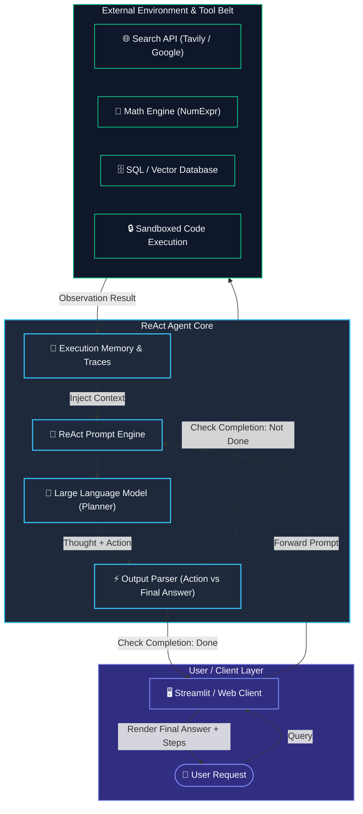
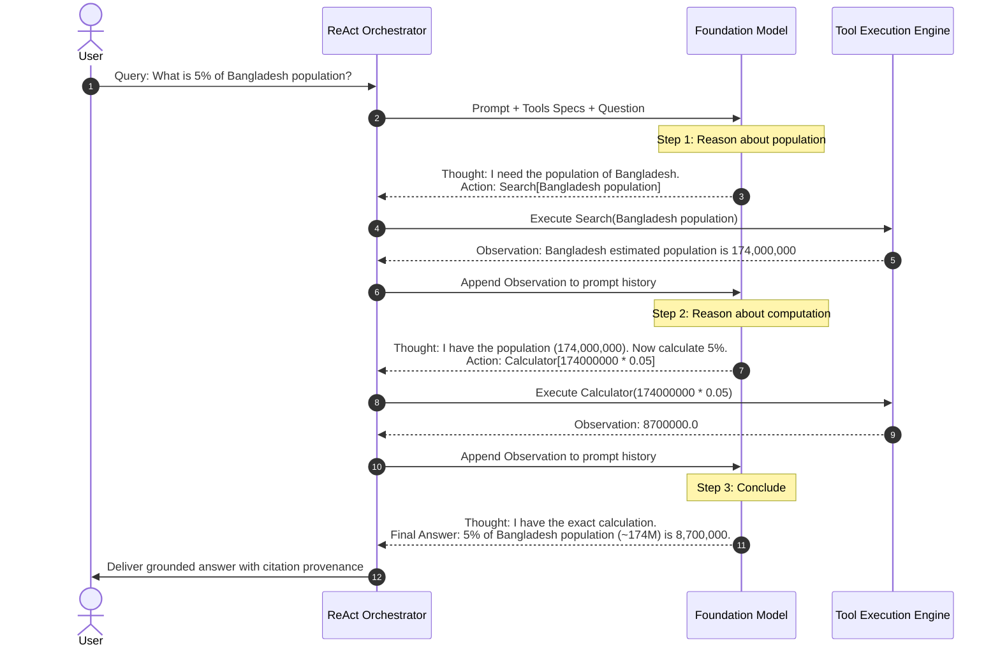

# ReAct Agent

> **Synergizing Reasoning and Acting in Language Models**

---

## What is a ReAct Agent?

**ReAct** stands for **Reasoning + Acting**. Introduced by Shunyu Yao et al. (Google Research & Princeton University, 2022) in the paper [*"ReAct: Synergizing Reasoning and Acting in Language Models"*](https://arxiv.org/abs/2210.03629), it is an agent framework where a Large Language Model (LLM) interleaves **reasoning traces** (*thoughts*) with **task-specific actions** (*tool executions*) and their environmental outcomes (*observations*).

```
   ┌────────────────────────────────────────────────────────┐
   │                  THE ReAct PARADIGM                    │
   │                                                        │
   │   Reasoning (Thought)  ──► Dynamic cognitive planning  │
   │            +                                           │
   │   Acting (Action)      ──► Tool & environment execution│
   │            +                                           │
   │   Feedback (Observation)─► Ground truth from the world │
   └────────────────────────────────────────────────────────┘
```

Rather than treating language models as closed-world question-answering engines, ReAct transforms the model into an **autonomous problem solver** that can:
- Formulate plans and hypotheses.
- Query external search engines, databases, APIs, or calculators.
- Inspect real-world responses to adjust its next steps dynamically.
- Synthesize an evidence-backed final answer.

---

## The Motivation: Why ReAct Matters

Pure Large Language Models suffer from fundamental boundaries:

1. **Static Knowledge Cutoff:** Models cannot answer questions about current events or live enterprise data without hallucinating.
2. **Arithmetic Incompetence:** Performing arithmetic with token probability distributions often fails on multi-digit numbers, percentages, or complex expressions.
3. **No Ground Truth Grounding:** Pure reasoning models ("Chain of Thought") can reason eloquently from incorrect premises—a phenomenon known as **hallucination cascading**.
4. **Action Myopia ("Act-Only"):** Systems that execute actions without deliberate reasoning lack situational awareness; they cannot plan several steps ahead, interpret noisy search snippets, or recover when an API call fails.

> [!NOTE]
> **The ReAct Breakthrough:** By combining internal reasoning (thinking) with external execution (acting), the reasoning trace guides action selection, while real-world observations correct and ground the reasoning trace.

---

## Paradigm Comparison

| Feature | Standard Prompting (Direct) | Chain of Thought (CoT) | Act-Only (Tool Calling) | ReAct (Reason + Act) |
| :--- | :--- | :--- | :--- | :--- |
| **Primary Mechanism** | Single-shot generation | Internal step-by-step thinking | Hardcoded action triggers | Interleaved Thought-Action-Observation |
| **External World Access** | ❌ None | ❌ None | ✅ Yes (APIs/Tools) | ✅ Yes (APIs/Tools) |
| **Live Knowledge Retrieval**| ❌ No | ❌ No | ✅ Yes | ✅ Yes (Grounded & auditable) |
| **Hallucination Risk** | 🔴 High | 🟡 Moderate | 🟡 Moderate | 🟢 Low (Fact-grounded) |
| **Mathematical Accuracy** | 🔴 Low | 🟡 Medium | 🟢 High (via tools) | 🟢 High (via tools + validation) |
| **Error Recovery** | ❌ None | ❌ None | 🔴 Weak (Blind retry) | 🟢 Strong (Inspects & refines) |
| **Interpretability / Tracing**| 🔴 Black-box | 🟡 Internal monologue | 🟡 Action logs only | 🟢 Full audit trail |

---

## How ReAct Works: The Core Loop

A ReAct agent runs inside a deterministic loop driven by structured stop tokens and output parsing:

```
[User Question]
       │
       ▼
 ┌───────────┐
 │  THOUGHT  │  ◄── "What is my current sub-goal? What tool do I need?"
 └─────┬─────┘
       │
       ▼
 ┌───────────┐
 │  ACTION   │  ◄── Select tool: ToolName[ToolInput]
 └─────┬─────┘
       │
       ▼
 ┌───────────┐
 │OBSERVATION│  ◄── Result returned from tool execution
 └─────┬─────┘
       │
       ├─────────────────────────────────┐
       ▼ (Need more info?)               ▼ (Goal achieved?)
[Next Thought / Action]            [FINAL ANSWER]
```

### The 4 Atomic Steps

1. **Thought (`Thought:`):**
   The agent explains *why* it needs to take an action, decomposes a multi-step query, or interprets the previous observation.
2. **Action (`Action:`):**
   The agent names the exact tool it has decided to invoke (e.g., `TavilySearch`, `Calculator`, `DatabaseQuery`).
3. **Action Input (`Action Input:`):**
   The structured parameters or string arguments passed into the chosen tool.
4. **Observation (`Observation:`):**
   The external environment's response injected back into the prompt buffer. The LLM reads this observation and produces the next `Thought:`.

When the agent realizes it has accumulated all necessary evidence, it issues:
- **Thought:** `I now know the final answer.`
- **Final Answer (`Final Answer:`):** The synthesized response grounded in observed facts.

---

## Architecture & Workflow Diagrams

### 1. High-Level System Architecture



---

### 2. Detailed Execution Sequence



---

## Anatomy of a ReAct Prompt

Under the hood, a ReAct agent relies on a specialized prompt template that establishes strict formatting constraints:

```text
Answer the following questions as best you can. You have access to the following tools:

Search: Useful for searching current world facts and web data.
Calculator: Useful for performing exact mathematical computations.

Use the following format:

Question: the input question you must answer
Thought: you should always think about what to do
Action: the action to take, should be one of [Search, Calculator]
Action Input: the input to the action
Observation: the result of the action
... (this Thought/Action/Action Input/Observation can repeat N times)
Thought: I now know the final answer
Final Answer: the final answer to the original input question

Begin!

Question: {input}
Thought:
```

> [!IMPORTANT]
> **Stop Sequences:** When calling the LLM, the stop token is configured to stop at `Observation:`. This forces the LLM to pause execution and hand control back to the orchestrator, which runs the requested tool and appends the actual real-world output.

---

## Comprehensive Step-by-Step Examples

### Example 1: Multi-Step Retrieval & Calculation

#### User Request:
> *"Who is the current CEO of Microsoft, how old is he, and what will his age squared be?"*

#### Complete ReAct Execution Trace:

```text
Question: Who is the current CEO of Microsoft, how old is he, and what will his age squared be?

Thought: First, I need to verify who the current CEO of Microsoft is and find his date of birth or current age.
Action: Search
Action Input: current CEO of Microsoft age birth date

Observation: Satya Nadella is the Chairman and CEO of Microsoft. He was born on August 19, 1967. As of early 2026, he is 58 years old.

Thought: Satya Nadella is 58 years old. Now I need to calculate his age squared (58^2).
Action: Calculator
Action Input: 58 ** 2

Observation: 3364

Thought: I have verified both facts: Satya Nadella is the CEO of Microsoft, he is 58 years old, and 58 squared is 3364. I am ready to formulate the final answer.
Final Answer: The current CEO of Microsoft is Satya Nadella. He is 58 years old (born August 19, 1967), and his age squared is 3,364.
```

---

### Example 2: Self-Correction & Error Recovery

One of ReAct's greatest superpowers is **handling failure gracefully**. If a search returns ambiguous data, or a calculator throws an exception, the agent inspects the error and course-corrects.

#### User Request:
> *"Find the stock price of TechCorpGlobal and calculate the market cap for 50M shares."*

#### ReAct Execution Trace showing self-correction:

```text
Question: Find the stock price of TechCorpGlobal and calculate the market cap for 50M shares.

Thought: I will search for the current stock ticker and price of TechCorpGlobal.
Action: Search
Action Input: TechCorpGlobal share price today

Observation: Error 404 / No exact match found for "TechCorpGlobal". Did you mean "TechCorp International" (ticker: TCG)?

Thought: The company name might be slightly different. Let me query for the official ticker symbol and stock quotes for TechCorp International.
Action: Search
Action Input: TechCorp International TCG stock price

Observation: TechCorp International (NYSE: TCG) is currently trading at $42.50 per share.

Thought: I found the stock price: $42.50 per share. The user specified 50 million shares. Let's calculate $42.50 * 50,000,000.
Action: Calculator
Action Input: 42.50 * 50,000,000

Observation: SyntaxError: invalid syntax (commas in numeric expression)

Thought: The calculator failed because I included commas in the number. I must sanitize the input and pass 50000000 without commas.
Action: Calculator
Action Input: 42.50 * 50000000

Observation: 2125000000.0

Thought: The calculation succeeded. 42.50 * 50,000,000 = 2,125,000,000 ($2.125 billion). I have all facts needed.
Final Answer: TechCorp International (TCG) is trading at $42.50 per share. For 50 million shares, the implied market capitalization is $2,125,000,000 ($2.125 billion).
```

---

### Example 3: Python Implementation with LangChain

Here is a clean, modern implementation showing how to configure and execute a ReAct agent using Python, LangChain, and structured tools:

```python
import os
import numexpr
from langchain.agents import AgentExecutor, create_react_agent
from langchain_core.tools import Tool
from langchain_community.tools.tavily_search import TavilySearchResults
from langchain_openai import ChatOpenAI
from langchain import hub

# 1. Define Deterministic Tools
def calculate_expression(expression: str) -> str:
    """Safely evaluates arithmetic expressions using numexpr."""
    clean_expr = expression.replace(",", "").strip()
    try:
        result = numexpr.evaluate(clean_expr, local_dict={}, global_dict={})
        return str(result)
    except Exception as e:
        return f"Calculation Error: {e}"

calculator_tool = Tool(
    name="Calculator",
    func=calculate_expression,
    description="Useful for mathematical calculations. Input must be a valid math string."
)

search_tool = TavilySearchResults(max_results=3)

tools = [search_tool, calculator_tool]

# 2. Initialize LLM & Pull Standard ReAct Prompt
llm = ChatOpenAI(model="gpt-4o", temperature=0)
prompt = hub.pull("hwchase17/react")

# 3. Construct ReAct Agent
agent = create_react_agent(llm=llm, tools=tools, prompt=prompt)

agent_executor = AgentExecutor(
    agent=agent,
    tools=tools,
    verbose=True,
    handle_parsing_errors=True,
    max_iterations=8
)

# 4. Run Query
if __name__ == "__main__":
    query = "Search for the current population of Tokyo and calculate 12% of that number."
    response = agent_executor.invoke({"input": query})
    print("\nResult:\n", response["output"])
```

---

## Key Strengths and Real-World Challenges

### Strengths
- 🎯 **Verifiable Factuality:** Every conclusion can be verified against its corresponding action's URL or raw data source.
- 🔄 **Autonomous Error Recovery:** Does not crash on tool exceptions; formulates alternative search queries or fixes input formats.
- 🧩 **Extensible Modularity:** Add tools (SQL query engines, GitHub APIs, document retrieval) without retraining the base LLM.
- 👁️ **Auditable Explainability:** The thought trail enables developers and compliance teams to pinpoint exactly *why* a decision was made.

### Real-World Challenges & Mitigations

| Challenge | Real-World Risk | Engineering Mitigation |
| :--- | :--- | :--- |
| **Infinite Loops** | Agent repeats identical failed search query indefinitely. | Enforce `max_iterations` (e.g., 5-8 steps) and cycle-detection algorithms. |
| **Parsing Errors** | Model outputs `action:` in lowercase or omits `Action Input:`. | Set `handle_parsing_errors=True` with regex-tolerant output parsers. |
| **Hallucinated Tools** | Model invents tools that do not exist (e.g. `ExecuteRocketLaunch`). | Strict schema validation with clear fallback prompts alerting the model of valid tools. |
| **Security / Remote Code Execution** | Unrestricted Python execution running hostile commands. | Never expose raw `eval()` or unsandboxed Python; use deterministic engines (`numexpr`) or microVM sandboxes. |
| **Token Cost & Latency** | Multi-hop reasoning loops consume 4x-10x more tokens than direct prompts. | Cache frequent search queries, limit search snippet lengths, and use performant compact models. |

---

## Best Practices for Production

> [!TIP]
> 1. **Sanitize Tool Inputs Deterministically:** Never pass raw LLM strings directly into native execution environments. Clean commas, whitespace, and special characters first.
> 2. **Isolate Code Execution:** Treat any code emitted by an LLM as untrusted. Run it in disposable Docker containers or WebAssembly runtimes with no internet access and strict memory caps.
> 3. **Implement Fallback Tools:** If a primary search provider returns a rate-limit error, provide a secondary fallback provider or graceful error message.
> 4. **Display Traces Responsibly:** When rendering traces in client interfaces (such as Streamlit), clearly distinguish between verifiable tool inputs/outputs and synthetic reasoning traces.

---

## Summary & Key Takeaways

```
                      ┌──────────────────────┐
                      │    USER QUESTION     │
                      └──────────┬───────────┘
                                 │
                     ┌───────────▼───────────┐
                     │  REASON (Plan & Why)  │
                     └───────────┬───────────┘
                                 │
                     ┌───────────▼───────────┐
                     │   ACT (Execute Tool)  │
                     └───────────┬───────────┘
                                 │
                     ┌───────────▼───────────┐
                     │ OBSERVE (Real World)  │
                     └───────────┬───────────┘
                                 │
                       [Goal Satisfied?]
                        ├── No  ──► Loop back to REASON
                        └── Yes ──► FINAL ANSWER
```

- **ReAct bridges the gap** between an LLM's internal intuition and the dynamic, real-world state.
- **Thought enables planning and tracking**, while **Action enables fact-checking and precision**.
- It is the foundation for modern autonomous agents, powering tools from code generation assistants to deep scientific research workflows.
